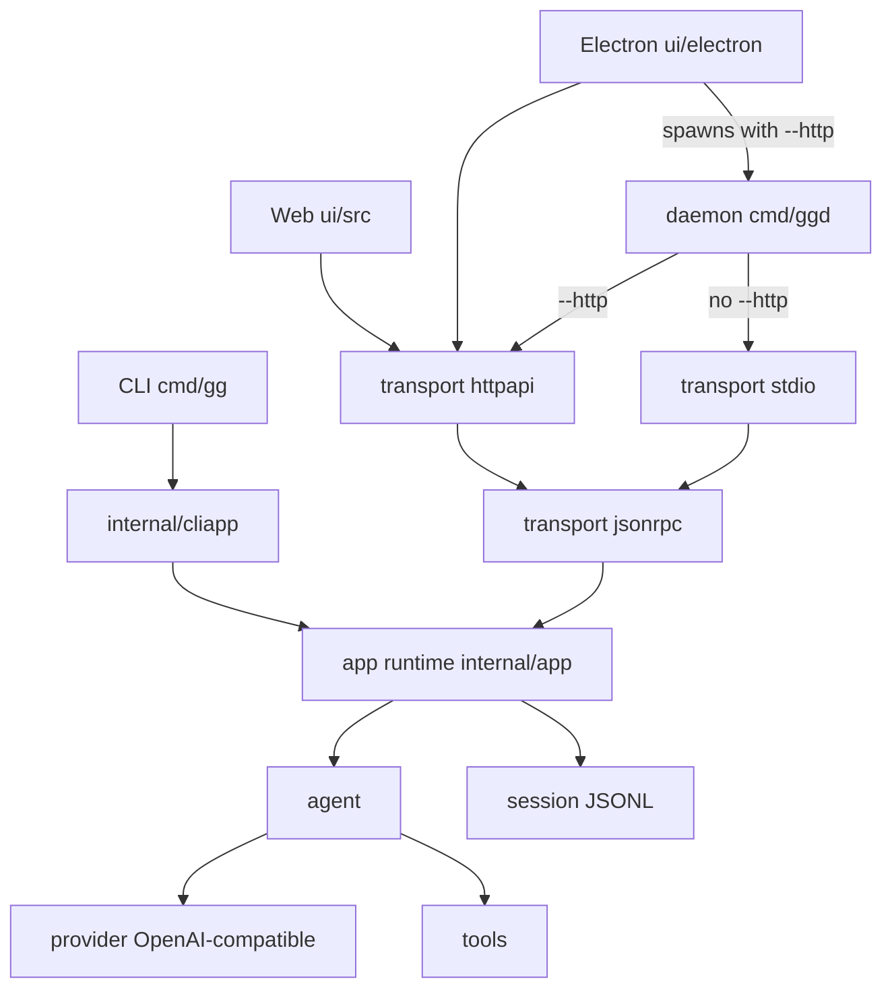

# gg

[](https://github.com/hszjj221/gg/actions/workflows/ci.yml)

English | [简体中文](README.zh-CN.md)

**gg is a terminal AI coding agent written in Go.** Point it at a repository, and it streams an OpenAI-compatible model that can read, search, and edit the project from your shell.

```bash
go install github.com/hszjj221/gg/cmd/gg@latest
```

Requires Go 1.26 or newer (`go 1.26` in `go.mod`). No GitHub release or tag is published, so `@latest` installs the newest commit on the default branch. From a checkout: `go run ./cmd/gg --help`.

## Demo

> **Placeholder — GIF not recorded.** Recording a typical session needs a live model API key, which is not available in this environment. The re-recordable script is [docs/demo.tape](docs/demo.tape) (Charmbracelet [VHS](https://github.com/charmbracelet/vhs)). From the repo root, with `gg` on `PATH` and `OPENAI_API_KEY` set:
>
> ```bash
> vhs docs/demo.tape
> ```
>
> That writes `docs/demo.gif`. The tape starts `gg`, asks it to explain `cmd/gg/main.go`, then asks it to run `go test` and approve the `bash` prompt.

## Architecture

The CLI runs the agent in-process. Web and Electron are separate clients of the same application runtime: they share one React UI and talk to the `ggd` daemon over HTTP. `ggd` speaks newline-delimited JSON-RPC on stdio unless `--http` is set; Electron starts it with `--http`.



`internal/agent` is the tool loop. `internal/provider/openai` is the only provider in v1. `internal/tools` is the built-in tool set (`read`, `list`, `grep`, `bash`, `edit`, `write`, plus optional capabilities). `internal/app` owns sessions, turns, approvals, and run lifecycle. `internal/session` stores an append-only JSONL tree. Dependency direction is clients and transports to `internal/app`, and `internal/app` to the agent and the session store.

## What was hard

### Security model

Tools run as the user. A nil approver inside the agent runner means allow, so every caller that can run tools passes an approver on purpose. The CLI policy lives in `internal/cliapp`.

| Mode | In a terminal | No terminal | Dangerous `bash` |
| --- | --- | --- | --- |
| `auto` (default) | prompt | deny, and say how to pass `--yolo` or `--approval on-request` | prompt in a terminal, otherwise deny |
| `on-request` | prompt | the process exits: this mode requires a terminal | prompt |
| `yolo` (`--yolo` or `--approval yolo`) | allow with no prompt | allow with no prompt | prompt in a terminal, otherwise deny |
| `never` | allow with no prompt | allow with no prompt | deny, because this mode never asks |

"In a terminal" means stdin and stderr are both terminals. `tools.ClassifyCommand` labels each `bash` command before that policy runs. Clearly read-only commands (`ls`, `cat`, `grep`, `git status` / `diff` / `log`, and a short allowlist) skip the prompt in every mode. Dangerous commands — `rm -rf` of `/` or a home directory, a pipe into a shell, `sudo`, `eval`, an interpreter one-liner, disk and format tools, writes that resolve outside the working directory — still need an interactive approval. `--yolo` does not waive them, and a scheduled job's `--allow-all` does not either: nothing is there to answer, so those commands are denied.

If `TYPESAFE_API_KEY` is set, commands the lists do not decide can be scored by TypeSafe Jev. A low score runs, a high score or a failed check asks (and `--yolo` does not skip that ask), and a score in between keeps the mode above. The key stays in the environment. It is not read from config and not written to logs. Without the key this check is off.

`--sandbox` is off by default. When it is set, `bash` tries bubblewrap on Linux or `sandbox-exec` on macOS, with the working directory writable and the rest of the filesystem read-only. If the helper is missing or cannot start, the command still runs and the output says the sandbox was unavailable. The sandbox does not confine the network, and it does not replace the approval check.

Full rules, the classifier's gaps, and the sandbox limits: [security model](docs/architecture.md#security-model).

### Streaming tool calls

`internal/provider/openai` always requests `stream: true`. Tool calls arrive as indexed fragments (id, name, argument bytes) and are assembled when the stream ends. A call with an empty id, an empty name, or arguments that are not a JSON object is an error. The runner then drops `ToolCalls` on that message so a partial call is never stored as something to execute. Network errors, HTTP 429, and 5xx responses retry before a stream is accepted (two retries, exponential backoff with jitter). An interrupted stream, a length limit, or incomplete tool arguments is returned as an error. Text that already streamed is kept.

### Interruption and resume

`cmd/gg` cancels on Ctrl+C. The runner records the partial assistant text, clears unfinished tool calls, and will not start a tool whose context is already canceled. Sessions are append-only JSONL. Opening a file whose last line is torn truncates back to the last valid bytes. A saved tool call with no result is left unreplayed, because the side effect may already have happened. Resume writes a tool result that the execution was interrupted and the result is unavailable, and the coding instructions tell the model to inspect the workspace before retrying. A second process that advanced the same file makes the stale writer fail with a conflict instead of interleaving two branches.

### Steering

The runner and the UI share `agent.MessageQueue`. Steering text is drained into the same run at model boundaries: before each provider request, and again when a reply finished with no further tool calls. Messages marked as follow-ups stay on that queue and are not injected into the current run. Web and Electron send both through JSON-RPC `run.steer`. Resolve and approval still happen in call order before any tool in that batch executes, so approval prompts stay in call order.

### Concurrency and lifecycle

One session has one active run. Different sessions may run at the same time. `ggd` admits 16 turns across workspaces by default and bounds a turn at 30 minutes (`--max-active-runs`, `--run-timeout`). Inside a turn, only tools that opt in may overlap — today `read` and `grep` — and at most four at once. Every other tool is a barrier before and after. A panicking tool becomes an error result. A panicking turn is recorded as failed so the daemon keeps serving. Shutdown cancels active turns, waits for workers, and closes browser and MCP subprocesses before it releases the daemon instance lock.

## Run

```bash
export OPENAI_API_KEY=sk-your-key
gg -p "List the files in this project"
```

`gg` with no prompt starts a line-oriented session (Ctrl+D to exit). Replies stream as they arrive. In a terminal, `bash`, `edit`, and `write` ask before they run.

Sessions, provider config, `AGENTS.md`, skills, memory, and the context budget are in the [usage reference](docs/usage.md).

For a separate personal assistant face, use `gg --profile personal`: stricter approval defaults, Gmail drafts, and a smaller [capability enable list](docs/core-plugin.md#profiles-and-coding-compatibility) on the shared runtime (media, computer, and MCP providers are disabled). Try `gg --profile personal proactive demo` for fake local digests and approval checks without credentials. The default remains coding. See [Personal Agent (P4 first slice)](docs/personal-agent.md).

## Extensions

These sit behind the terminal agent. Each one is real code in this repo; the linked page is the reference.

| | | |
| --- | --- | --- |
| Web and Electron | Shared React UI. Electron launches `ggd` as a loopback sidecar. | [Usage](docs/usage.md#web-and-electron) |
| Scheduler | Cron and one-shot jobs while `ggd` is running. | [Usage](docs/usage.md#scheduler) |
| Connectors | Google OAuth for Gmail and Calendar. | [Connectors](docs/connectors.md) |
| Media | Image generation, TTS, and STT on OpenAI-compatible endpoints. | [Media](docs/media.md) |
| Browser | Headless Chromium over CDP: navigate, read, screenshot. | [Browser](docs/browser.md) |
| Telegram | `ggd` answers allowlisted chats, including voice. | [Telegram](docs/telegram.md) |
| Knowledge base | Local RAG index and a `kb_search` tool. | [RAG](docs/rag.md) |
| Artifacts and library | Versioned documents and a personal file library. | [Usage](docs/usage.md#artifacts-and-library) |
| MCP | External tools declared in `~/.gg/mcp.json`. | [Architecture](docs/architecture.md#mcp-servers) |
| Computer tools | OS info, processes, clipboard, and approval-gated OS notifications on Linux and macOS. | [Usage](docs/usage.md#computer-tools) |
| Diagnostics | JSON logs on stderr and how to follow a run. | [Diagnostics](docs/diagnostics.md) |

Package boundaries and the JSON-RPC surface: [architecture](docs/architecture.md).

## Security

Run `gg` only in workspaces where you are willing to grant the model those tools. `~/.gg/config.json` may contain API keys. When memory is enabled, profile and memory files are sent to the selected provider. `memory_add` goes through the normal approval gate; `--yolo` or approval mode `never` skips the prompt.

Report vulnerabilities privately. See [SECURITY.md](SECURITY.md).

## License

MIT. See [LICENSE](LICENSE). Development setup is in [CONTRIBUTING.md](CONTRIBUTING.md).
