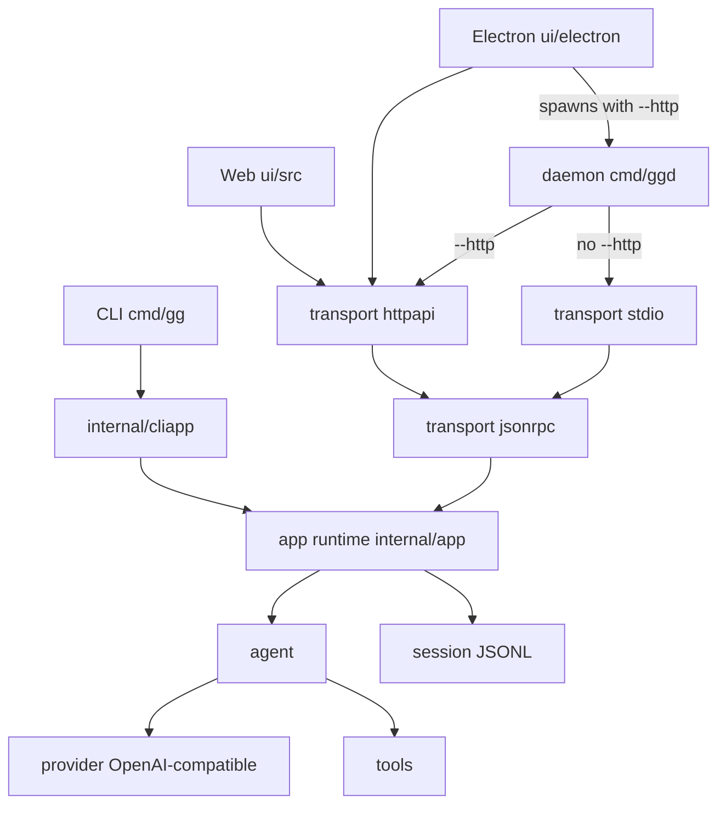

# gg

[](https://github.com/hszjj221/gg/actions/workflows/ci.yml)

[English](README.md) | 简体中文

**gg 是一个用 Go 写的终端 AI 编程 agent。** 把它指向一个仓库，它会流式调用 OpenAI-compatible 模型，并在你的 shell 里读、搜、改这个项目。

```bash
go install github.com/hszjj221/gg/cmd/gg@latest
```

需要 Go 1.26 或更新（`go.mod` 里是 `go 1.26`）。仓库没有 GitHub release，也没有 tag，所以 `@latest` 安装的是默认分支上的最新提交。在本地 checkout 里：`go run ./cmd/gg --help`。

## Demo

> **占位 — 尚未录制 GIF。** 录一段真实终端会话需要可用的模型 API key，当前环境没有。可重录的脚本是 [docs/demo.tape](docs/demo.tape)（Charmbracelet [VHS](https://github.com/charmbracelet/vhs)）。在仓库根目录、`PATH` 里有 `gg`、并且设置了 `OPENAI_API_KEY` 之后：
>
> ```bash
> vhs docs/demo.tape
> ```
>
> 脚本会写出 `docs/demo.gif`。它先启动 `gg`，让它解释 `cmd/gg/main.go`，再让它跑 `go test` 并在 `bash` 审批提示上回答批准。

## 架构

CLI 在进程内跑 agent。Web 和 Electron 是同一套应用运行时的另外两个客户端：它们共享一套 React UI，通过 HTTP 连接 `ggd` daemon。`ggd` 默认在 stdio 上跑换行分隔的 JSON-RPC，除非加上 `--http`；Electron 启动它时会带 `--http`。



`internal/agent` 是工具循环。`internal/provider/openai` 是 v1 唯一的 provider。`internal/tools` 是内置工具（`read`、`list`、`grep`、`bash`、`edit`、`write`，以及可选能力）。`internal/app` 负责会话、轮次、审批和运行生命周期。`internal/session` 保存只追加的 JSONL 会话树。依赖方向是客户端和传输层指向 `internal/app`，`internal/app` 再指向 agent 和会话存储。

## 难在哪里

### 安全模型

工具以当前用户的权限运行。agent runner 里 nil approver 表示放行，所以每个会跑工具的调用方都显式传入 approver。CLI 策略在 `internal/cliapp`。

| 模式 | 有终端 | 没有终端 | 危险 `bash` |
| --- | --- | --- | --- |
| `auto`（默认） | 询问 | 拒绝，并说明可以传 `--yolo` 或 `--approval on-request` | 有终端就询问，否则拒绝 |
| `on-request` | 询问 | 进程直接退出：这个模式要求终端 | 询问 |
| `yolo`（`--yolo` 或 `--approval yolo`） | 不询问直接放行 | 不询问直接放行 | 有终端就询问，否则拒绝 |
| `never` | 不询问直接放行 | 不询问直接放行 | 拒绝，因为这个模式从不询问 |

“有终端”指 stdin 和 stderr 都是终端。`tools.ClassifyCommand` 会在策略执行前给每条 `bash` 命令打标签。明显只读的命令（`ls`、`cat`、`grep`、`git status` / `diff` / `log`，以及一份短名单）在所有模式下都不询问。危险命令包括：`rm -rf` 指向 `/` 或家目录、下载内容管道进 shell、`sudo`、磁盘和格式化工具、解析后落在工作目录之外的写入。这些命令仍然要交互确认。`--yolo` 不能跳过；定时任务的 `--allow-all` 也不能跳过，因为当时没有人可以回答，所以直接拒绝。

`--sandbox` 默认关闭。打开后，`bash` 在 Linux 上尝试 bubblewrap，在 macOS 上尝试 `sandbox-exec`：工作目录可写，其余文件系统只读。helper 缺失或无法启动时，命令仍会执行，输出里会说明沙箱不可用。沙箱不隔离网络。

完整规则、分类器覆盖不到的情况，以及沙箱边界见[安全模型](docs/architecture.zh-CN.md#安全模型)。

### 流式工具调用

`internal/provider/openai` 始终请求 `stream: true`。工具调用以带下标的片段到达（id、name、参数字节），流结束时才组装。id 为空、name 为空，或参数不是 JSON 对象，都是错误。runner 随后清掉这条消息上的 `ToolCalls`，半截调用不会被存成可执行调用。网络错误、HTTP 429 和 5xx 会在流被接受之前重试（最多两次，指数退避加抖动）。流中断、达到长度上限，或工具参数不完整，会作为错误返回。已经流出来的文本会保留。

### 中断与恢复

`cmd/gg` 在 Ctrl+C 时取消上下文。runner 记下已经流出的 assistant 文本，清掉未完成的工具调用，并且不会启动一个上下文已经取消的工具。会话是只追加的 JSONL。打开文件时如果最后一行写坏了，会截回最后一段有效字节。已经落盘、但没有结果的工具调用不会重放，因为副作用可能已经发生。恢复时会写入一条工具结果，说明执行被中断、结果不可用；编码指令要求模型先检查工作区再决定是否重试。另一个进程已经推进了同一个文件时，过期的写入方会得到冲突错误，两条分支不会交错写进同一个文件。

### Steering

runner 和 UI 共用 `agent.MessageQueue`。steering 文本在模型边界被取进同一轮：每次请求 provider 之前，以及一条回复已经结束、后面没有工具调用的时候。标成 follow-up 的消息留在这个队列上，不会注入当前这一轮。Web 和 Electron 都通过 JSON-RPC `run.steer` 发送这两种消息。同一批工具里，解析和审批仍按调用顺序完成，然后才执行，审批提示也按这个顺序出现。

### 并发与生命周期

一个会话同时只有一轮运行。不同会话可以同时跑。`ggd` 默认跨工作区最多接纳 16 轮，单轮上限 30 分钟（`--max-active-runs`、`--run-timeout`）。一轮之内，只有主动声明可并行的工具可以重叠——目前是 `read` 和 `grep`——同时最多 4 个。其他工具前后都是屏障。工具 panic 会变成一条错误结果。一轮 panic 会被记为失败，daemon 继续服务。关闭时会取消进行中的轮次、等待 worker，并在释放 daemon 实例锁之前关掉 browser 和 MCP 子进程。

## 运行

```bash
export OPENAI_API_KEY=sk-your-key
gg -p "List the files in this project"
```

不带 prompt 运行 `gg` 会进入按行交互的会话（Ctrl+D 退出）。回复随生成随输出。在终端里，`bash`、`edit`、`write` 运行前会询问。

会话、provider 配置、`AGENTS.md`、skills、memory 和上下文预算见[使用说明](docs/usage.zh-CN.md)。

独立的个人助理面使用 `gg --profile personal`：在共享运行时上采用更严格的审批默认值、Gmail 草稿偏好和更小的[能力启用列表](docs/core-plugin.zh-CN.md#profile-与-coding-兼容性)（禁用 media、computer 与 MCP provider）。可运行 `gg --profile personal proactive demo`，无需凭据即可体验假数据本地摘要和审批检查。默认仍为 coding。参见 [Personal Agent（P4 首个切片）](docs/personal-agent.zh-CN.md)。

## 扩展

这些能力在终端 agent 之外，都是这个仓库里的真实代码。链接是对应的说明。

| | | |
| --- | --- | --- |
| Web 与 Electron | 共享的 React UI。Electron 把 `ggd` 作为 loopback sidecar 拉起。 | [使用说明](docs/usage.zh-CN.md#web-and-electron) |
| 定时任务 | `ggd` 运行期间触发的 cron 和一次性任务。 | [使用说明](docs/usage.zh-CN.md#scheduler) |
| Connectors | Google OAuth，接入 Gmail 和 Calendar。 | [Connectors](docs/connectors.zh-CN.md) |
| 媒体 | 走 OpenAI-compatible 端点的图片生成、TTS、STT。 | [媒体](docs/media.zh-CN.md) |
| 浏览器 | Headless Chromium（CDP）：导航、读取、截图。 | [浏览器](docs/browser.zh-CN.md) |
| Telegram | `ggd` 回复允许列表里的 chat，包括语音。 | [Telegram](docs/telegram.zh-CN.md) |
| 知识库 | 本地 RAG 索引和 `kb_search` 工具。 | [RAG](docs/rag.zh-CN.md) |
| Artifacts 与 library | 带版本的文档和个人文件库。 | [使用说明](docs/usage.zh-CN.md#artifacts-and-library) |
| MCP | `~/.gg/mcp.json` 里声明的外部工具。 | [架构](docs/architecture.zh-CN.md#mcp-servers) |
| 电脑操作 | Linux 和 macOS 上的系统信息、进程、剪贴板和需审批的 OS 通知。 | [使用说明](docs/usage.zh-CN.md#computer-tools) |
| 诊断 | stderr 上的 JSON 日志，以及如何跟踪一轮运行。 | [诊断](docs/diagnostics.zh-CN.md) |

包边界和 JSON-RPC 接口见[架构文档](docs/architecture.zh-CN.md)。

## 安全

只在你愿意把这些工具交给模型的工作区里运行 `gg`。`~/.gg/config.json` 里可能有 API key。启用 memory 时，画像和记忆文件会发给当前选中的 provider。`memory_add` 走正常审批门禁；`--yolo` 或审批模式 `never` 会跳过提示。

请私下报告漏洞。参见 [SECURITY.md](SECURITY.md)。

## 许可证

MIT。参见 [LICENSE](LICENSE)。开发环境见 [CONTRIBUTING.md](CONTRIBUTING.md)。
